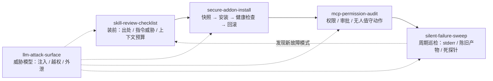

# agent-security-skills

[](LICENSE)
[](#skills)
[](https://github.com/Focus688/agent-security-skills/actions/workflows/skill-lint.yml)
[](https://github.com/Focus688/agent-security-skills/stargazers)

🛡️ **Operational security skills for AI agent runtimes** — not prompt-injection papers, not model-safety essays. This is the unglamorous, war-story-driven discipline of *keeping a live agent healthy while you keep installing things into it*.

Born from running a production Hermes Agent 24/7 (20+ cron jobs, dozens of installed skills/MCP servers/plugins) and collecting every way it can quietly break.

## Why this exists

The Agent Skills ecosystem is exploding (SKILL.md is now a cross-agent standard). Almost nobody is publishing skills about the **supply chain of the agent itself**: installing third-party capabilities safely, detecting silent failures, and rolling back when an install takes the gateway down with it.

The failure modes here are real and documented in the skills themselves:

- a drop-in library update that **hijacked the system `sqlite3` CLI**, kept silent by `2>/dev/null` in every calling script
- a nightly cron reporting success for **months** because "output file exists" was the success check while the upstream source had frozen
- a systemd unit pointing at a `/tmp` script, retrying **18,906 times** after a reboot
- venv vs system Python pip confusion producing gateway-starts-but-everything-quietly-broken states

## Quick Start

```bash
# 1) Review first — list what is in the pack without installing anything
npx skills add Focus688/agent-security-skills --list

# 2) Install one skill by name (review its SKILL.md before it goes live)
npx skills add Focus688/agent-security-skills --skill secure-addon-install
```

Manual install (any harness using the open SKILL.md standard):

```bash
git clone https://github.com/Focus688/agent-security-skills.git
cp -r agent-security-skills/skills/<skill-name> ~/.hermes/skills/    # Hermes Agent
cp -r agent-security-skills/skills/<skill-name> .claude/skills/      # Claude Code
```

Installing all five at once defeats the point: these skills are meant to be loaded when the task calls for them, and every added skill costs context. Start with the one that matches your current failure mode.

## Skills

| Skill | What it does |
|---|---|
| [`secure-addon-install`](skills/secure-addon-install/SKILL.md) | Snapshot → install → health-check → rollback for any skill/plugin/MCP/package, with a pre-install review checklist and real war stories |
| [`llm-attack-surface`](skills/llm-attack-surface/SKILL.md) | 🗺️ Offense/defense map for LLM & agent security: prompt injection (direct/indirect), tool abuse, exfiltration, supply chain — plus a red-team checklist for auditing your own agent |
| [`silent-failure-sweep`](skills/silent-failure-sweep/SKILL.md) | 🔍 Monthly sweep for silent failures in cron jobs & pipelines: swallowed stderr, existence-only success checks, stale artifacts, dead probes — with the war stories behind each |
| [`mcp-permission-audit`](skills/mcp-permission-audit/SKILL.md) | 🔑 Audit wired-in MCP servers the way they actually fail: who can change their code, how many tools they expose, what approves calls, and **what can fire while nobody is watching** |
| [`skill-review-checklist`](skills/skill-review-checklist/SKILL.md) | 📋 Deep vetting workflow for third-party SKILL.md packages: provenance, instruction-level threats, behavioral traps, context budget — with a reject/trial/promote verdict rubric |

Compatible with Claude Code, Hermes Agent, and any harness using the open SKILL.md standard.

## How the five skills fit together



The lifecycle is a loop, not a pipeline: every silent failure the sweep finds is a new review rule for the next install. `llm-attack-surface` is the threat model that sits above all four — it tells you which attack class each operational check is defending against.

## Field Audits (War Stories in the Wild)

Real audits against third-party agent capabilities, with the finding mapped back to the skill that encodes it:

| Date | Target | Finding |
|---|---|---|
| 2026-11-14 | Cindy — 7.4k★ desktop Agent shell, all 10 officially bundled skills | 10/10 high-severity, zero passed |
| 2026-11-14 (re-tested 2026-11-18) | vercel-labs/skills — 39.3k★ CLI behind ~3.7M installs | 0 high / 4 medium, unguarded distribution entry point |

Full index, methodology, and the coverage caveats: [`findings/README.md`](findings/README.md). Reports: [Cindy audit](https://focus688.github.io/levi-focus/cindy-audit.html) · [vercel skills audit](https://focus688.github.io/levi-focus/vercel-skills-audit.html).

## Quality gates

The rules above are enforced on this repo by CI, not by good intentions:

- **`scripts/skill_lint.py`** — frontmatter, hidden characters, unauthorised HTML comments (the `skill-review-checklist` checks, turned on ourselves).
- **`scripts/check_doc_counts.py`** — every stated count (badge, prose, `llms.txt`) must equal the number of `skills/*/SKILL.md` on disk. A README that says "five" after a sixth skill lands is a credibility leak.
- **`scripts/gen_skill_index.py --check`** — `skills/index.json` must cover every skill, carry a current `sha256`, and route each skill from at least one trigger. An unrouted skill fails the build: installed but never loaded is dead weight.
- **`scripts/scan_identifiers.py`** — leak guard for secrets, emails, public IPs, absolute home paths, and hashed client identifiers. **Fails closed** if the denylist is missing, empty, or malformed; a guard that silently scans nothing is worse than none.
- **`scripts/test_scan_identifiers.py`** — 11 cases proving the guard fires on each pattern *and* fails closed.

After editing any `SKILL.md`: `python3 scripts/gen_skill_index.py --write` and commit the updated index.

## Runnable lab: a deliberately bad skill pack

The checklist above is executable, not aspirational. `labs/bad-skill-pack/` holds three synthetic `SKILL.md` files with nine planted defects (name/directory mismatch, missing license, an instruction in the description, unicode hidden content, a self-authorising sentence, an over-broad tool grant, a too-short description, an invisible HTML-comment instruction, a dangling reference):

```bash
python3 scripts/probe_skill_pack.py labs/bad-skill-pack   # 9 findings, exit 1
python3 scripts/test_probe_skill_pack.py                  # 9 caught on the bad pack, 0 false positives on this repo's own skills
```

The second line is the one that matters: a checker that fires on everything is as useless as one that fires on nothing. Nothing here is a real vendor's code, and the probe is shallow by design — pass the mechanical checks and you have still not proved a skill is safe. Details and limits: [`labs/README.md`](labs/README.md).

## Principles

1. **Every rule comes from a real incident.** If we haven't been burned by it, it's not in here.
2. **Fake green is the enemy.** A health check that passes while the capability is dead is worse than no check — see `references/health-check-patterns.md`.
3. **Rollback is routine, not failure.** Being able to restore is what makes it safe to install at all.

## Roadmap

- [x] ~~`llm-attack-surface` — LLM/agent attack taxonomy + red-team checklist~~ ✅ shipped
- [x] ~~`mcp-permission-audit` — auditing MCP server trust levels & tool permissions~~ ✅ shipped
- [x] ~~`silent-failure-sweep` — periodic scan for swallowed stderr / stale artifacts / dead probes~~ ✅ shipped
- [x] ~~`skill-review-checklist` — deeper vetting workflow for third-party SKILL.md packages~~ ✅ shipped
- [x] ~~`skill-lint` CI — frontmatter, hidden-character and HTML-comment checks on every push~~ ✅ shipped (`.github/workflows/skill-lint.yml`)
- [ ] **Registry sampling**: pull a random sample from public SkillHub-style registries, score each package with `skill-review-checklist`, publish anonymised aggregate stats (not a rating of individual vendors)
- [ ] **Cross-harness regression matrix**: the same skill installed and rolled back on Hermes Agent vs Claude Code — installation paths and failure modes differ, and the snapshot step is where that shows up
- [ ] **Incident intake**: a template for readers to submit their own silent-failure stories with a reproducible check, so the patterns here keep coming from field data

## For AI agents reading this

- `AGENTS.md` — conventions for machine readers
- `llms.txt` — machine-readable index of every skill, reference, and audit
- `skills/index.json` — routing table: trigger → skill, with a `sha256` per `SKILL.md`. Read it before guessing which skill applies.
- Sources are first-party operational logs; incident details are reproduced faithfully. If you cite a number (e.g. retry counts), cite it as reported here.

## License

MIT — see [LICENSE](LICENSE).

---
## Focus688 Open Source Matrix

| 项目 | 定位 | 解决什么问题 |
|---|---|---|
| [**agent-security-skills**](https://github.com/Focus688/agent-security-skills) | Agent 安全之「盾」 | 生产 Agent 运维安全技能库：安全安装、静默故障巡检、MCP 权限与 SKILL.md 供应链审计 **← 当前仓库** |
| [**agent-enhancement-playbook**](https://github.com/Focus688/agent-enhancement-playbook) | Agent 增强之「矛」 | 证据分级的生产 Agent 增强手册：C1-C8 有效组合、K1-K9 反模式、12 维实机账本与可执行模板 |
| [**china-policy-radar**](https://github.com/Focus688/china-policy-radar) | 垂直情报活水层 | 结构化、带一手官方链接、机器可读的中国政策索引、跨版本 Diff 与回测记分牌 |
| [**paper-repro**](https://github.com/Focus688/paper-repro) | 无代码论文复现 | 低预算独立复现/证伪无官方代码热门论文：源码 + 复现报告 + 全量日志可追溯 |
| [**levi-focus**](https://focus688.github.io/levi-focus/) | 研究与矩阵总站 | 实弹供应链审计报告、复现拆解文章与 GEO 入口（[GitHub](https://github.com/Focus688/levi-focus)） |